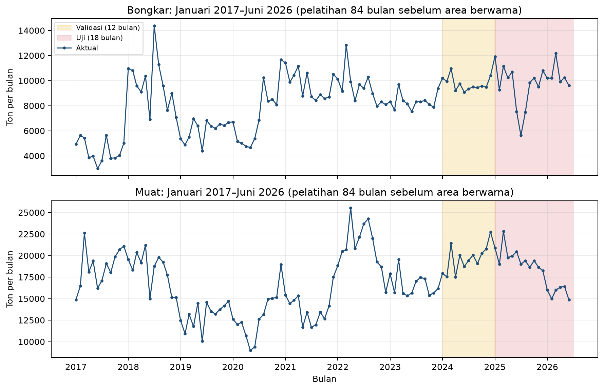
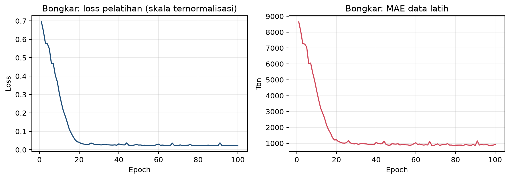
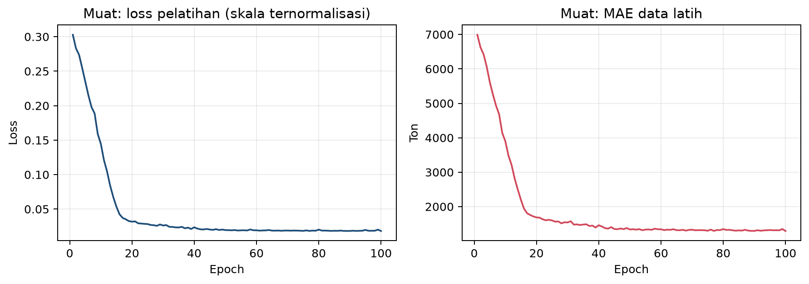
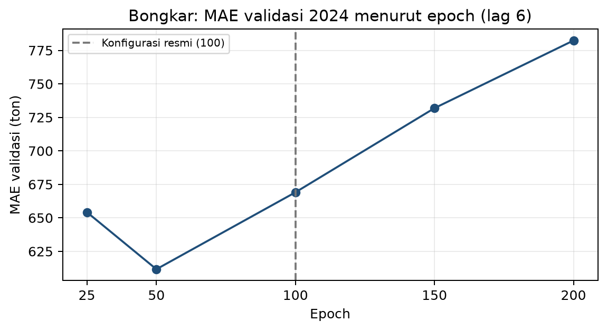
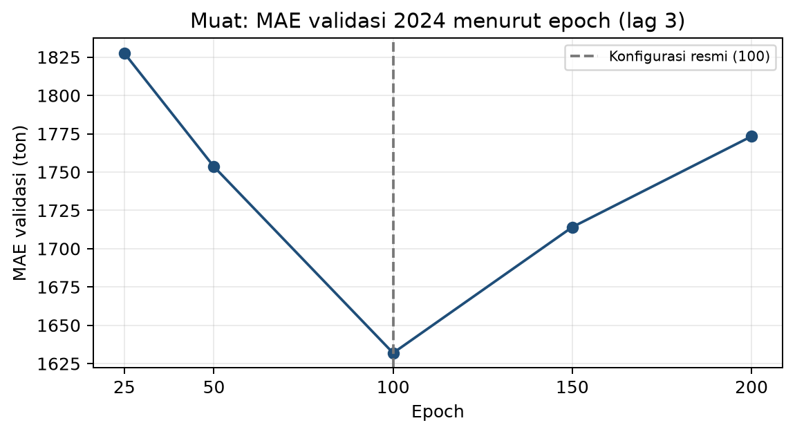

# Diagnostik pelatihan tambahan

Analisis offline ini menjawab dua pertanyaan: bagaimana loss berkembang selama 100 epoch, dan apakah jumlah epoch lain akan memberi MAE validasi yang sangat berbeda. Hasil resmi, lag, seed, dan 100 epoch tidak diubah.

## Kurva loss model uji resmi

Model dilatih ulang pada 96 bulan (Januari 2017–Desember 2024) dengan konfigurasi resmi. Fit ulang ini mereproduksi 18 prediksi uji resmi; selisih maksimum dicatat di bawah. Loss dihitung NeuralProphet pada skala ternormalisasi, sedangkan MAE latih dalam ton.

| Deret | Lag | Selisih maks. terhadap prediksi resmi (ton) | Loss epoch 1 | Loss epoch 50 | Loss epoch 100 | MAE latih epoch 100 (ton) |
| --- | ---: | ---: | ---: | ---: | ---: | ---: |
| Bongkar | 6 | 0,000000 | 0,6944 | 0,0255 | 0,0241 | 925,23 |
| Muat | 3 | 0,000000 | 0,3028 | 0,0196 | 0,0182 | 1.291,83 |

## Sensitivitas epoch pada validasi 2024

Kandidat dilatih pada 84 bulan dengan lag resmi dan seed 42, lalu dinilai pada 12 bulan validasi dengan prosedur satu langkah yang sama. Data uji tidak dipakai. NeuralProphet menyesuaikan jadwal learning rate dengan jumlah epoch, sehingga setiap baris adalah pelatihan lengkap tersendiri.

| Deret | Epoch | MAE validasi (ton) | RMSE validasi (ton) | MAPE validasi (%) |
| --- | ---: | ---: | ---: | ---: |
| Bongkar | 25 | 654,25 | 782,24 | 6,66 |
| Bongkar | 50 | 611,65 | 701,35 | 6,40 |
| Bongkar | 100 (resmi) | 669,06 | 758,39 | 6,99 |
| Bongkar | 150 | 731,88 | 822,53 | 7,63 |
| Bongkar | 200 | 782,37 | 880,20 | 8,15 |
| Muat | 25 | 1.827,61 | 2.076,94 | 9,20 |
| Muat | 50 | 1.753,50 | 2.025,27 | 8,85 |
| Muat | 100 (resmi) | 1.631,90 | 1.882,20 | 8,29 |
| Muat | 150 | 1.714,07 | 1.924,37 | 8,73 |
| Muat | 200 | 1.773,30 | 1.966,58 | 9,04 |

## Batas interpretasi

Analisis epoch dilakukan setelah eksperimen resmi dan hanya memakai validasi. Hasilnya menunjukkan kepekaan, bukan dasar mengganti 100 epoch; memilih epoch terbaik dari tabel ini lalu melaporkannya pada data uji akan menjadi pemilihan ulang konfigurasi. Kurva loss latih yang menurun tidak membuktikan model bebas overfitting; bukti kinerja di luar data latih tetap berasal dari validasi dan uji kronologis.

SHA-256 laporan resmi: `ceb808f172f90de63350565bb661f29d75a8d9c3b8957fc5900299f8b49b0f7f`. Jalankan ulang dengan `python training_diagnostics.py`.
